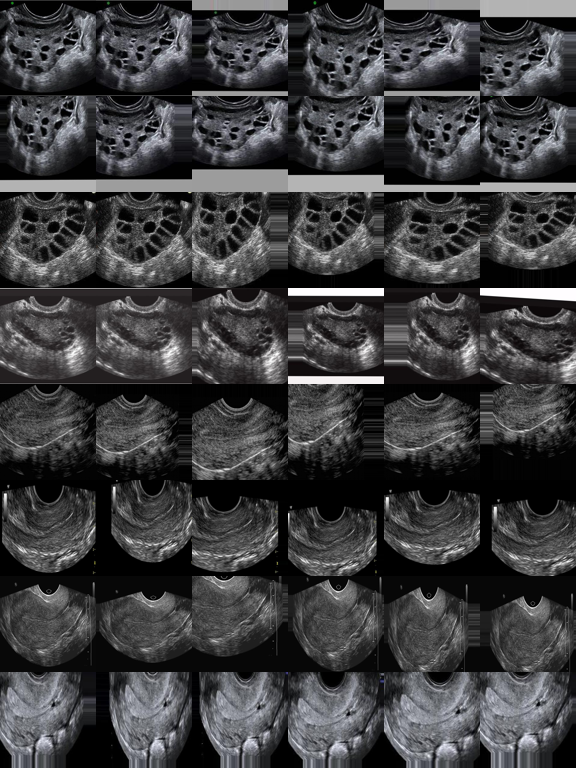

# OvaScan: PCOS ultrasound screening (research prototype)

> 🚧 **Work in progress.** A personal project on applying ML to women's health.
> **Not a medical device.** It does not diagnose anything and must not be used for medical decisions.

OvaScan looks at an ovarian ultrasound image and reports one of three results:

| Result | Meaning |
|---|---|
| 🟢 **No PCOS-like features** | Model score < 30% |
| 🟠 **Inconclusive** | Score 30-70%: unclear image, a different structure, or unlike the training data |
| 🔴 **PCOS-like features** | Score > 70%: pattern similar to polycystic ovarian morphology |

It then gives a **lifestyle plan** (activity, nutrition, sleep and wellbeing, questions for your doctor).
The plan follows the **2023 International Evidence-based PCOS Guideline** and can be personalised with
optional self-reported habits. It never suggests medication.

> **Why "PCOS-like" and not "PCOS"?** PCOS (often called PCOD in India) is diagnosed with the
> Rotterdam criteria: at least 2 of irregular cycles, high androgens, and polycystic ovaries on
> ultrasound. An image covers only one of these three, so the app always refers people to a clinician.

---

## The most important finding: the data, not the model

The project started as a Colab notebook ([`notebooks/colab_prototype.py`](notebooks/colab_prototype.py))
that trained a CNN on a [public Kaggle PCOS ultrasound dataset](https://www.kaggle.com/datasets/anaghachoudhari/pcos-detection-using-ultrasound-images).
Before reporting any accuracy, I audited the data ([`scripts/audit_dataset.py`](scripts/audit_dataset.py), full report in
[`reports/data_audit.md`](reports/data_audit.md)):

1. **The test set is a copy of the training set.** Of 3,856 files only 1,922 are unique, and
   1,920 of those appear in *both* `train/` and `test/`. Any accuracy measured on the given test
   split is memorisation.
2. **~1,900 images come from only ~22 source scans.** Most files are flips, zooms or shifts of
   the same scan. I grouped them into "families" with CNN embeddings and clustering, and every family is
   kept in exactly one of train/val/test.
3. **Shortcut risk.** Many "healthy" images show the *uterus*, not an ovary. A model can tell
   the classes apart by *which organ is visible* without ever learning what a polycystic ovary looks like.




*Each row is one detected family: one original scan plus its augmented copies.*

### Results on the leakage-free split

| | Original notebook | This repo |
|---|---|---|
| Split | given `train/` vs `test/` (identical) | grouped by scan family |
| Test images / independent scans | 1,932 / ~22 (all seen in training) | 578 / **5** (unseen) |
| Test accuracy | meaningless (leakage) | 100% (see below) |

The model ([MobileNetV3-Small](pcos_screen/model.py), ImageNet-pretrained, fine-tuned on CPU) classifies
all 5 unseen test scans correctly. **I do not consider this evidence that it works.** Five scans
are too few to estimate performance, and the organ shortcut above makes the task artificially easy.
Honest conclusion: *the pipeline is ready, the dataset is not.* Full numbers are in
[`reports/metrics.json`](reports/metrics.json).

Sanity check: random noise, blank images and cartoon "follicles" all land in the **Inconclusive** band,
which is why the app uses three bands instead of a yes/no threshold.

---

## Run it

```bash
python -m venv .venv
.venv\Scripts\activate          # Windows  (macOS/Linux: source .venv/bin/activate)
pip install -r requirements.txt

# Optional: re-run audit + training (download the Kaggle dataset into dataset/data/ first)
python scripts/audit_dataset.py --data dataset/data
python scripts/train.py --epochs 8

streamlit run app.py            # the trained weights are included in models/
pytest -q                       # tests for result bands, leakage-free split and lifestyle rules
```

## Project layout

```
app.py                     Streamlit demo (upload -> result band -> lifestyle plan)
pcos_screen/
  data.py                  dedup, augmentation-family clustering, group-aware split
  model.py                 MobileNetV3 model, preprocessing, result bands, Predictor
  lifestyle.py             guideline-based, rule-driven lifestyle plan
scripts/
  audit_dataset.py         leakage audit -> reports/data_audit.md, splits/split.csv
  train.py                 training + evaluation -> models/, reports/metrics.json
notebooks/colab_prototype.py   original Colab prototype (kept for history)
tests/                     pytest suite
```

## Roadmap

- [x] Original CNN prototype (Colab, TensorFlow/Keras)
- [x] Data audit: exact duplicates, augmentation families, shortcut risk
- [x] Leakage-free, family-grouped split, and a reproducible PyTorch pipeline
- [x] Three-band output with an explicit "inconclusive" zone
- [x] Guideline-based lifestyle plan + Streamlit demo
- [ ] **Better data:** a dataset with many independent patients and ovary-only views, with clinician labels
- [ ] Patient-level cross-validation with confidence intervals (sensitivity/specificity, not just accuracy)
- [ ] Out-of-distribution check ("this doesn't look like an ovarian ultrasound")
- [ ] Explainability (Grad-CAM) to check that the model looks at follicles, not at organ shape or scanner text
- [ ] Combine image result with symptom questionnaire (cycle, androgen signs) to mirror Rotterdam criteria
- [ ] Learn the regulatory path for software as a medical device (EU MDR, IEC 62304, ISO 14971) and GDPR for health data

## Disclaimer

For education and research only. Not validated, not CE-marked, not a substitute for professional
medical advice. If you have concerns about PCOS, please see a gynaecologist or GP.

## Reference

Teede HJ et al. *Recommendations from the 2023 International Evidence-based Guideline for the
Assessment and Management of Polycystic Ovary Syndrome.* J Clin Endocrinol Metab. 2023;108(10):2447-2469.
