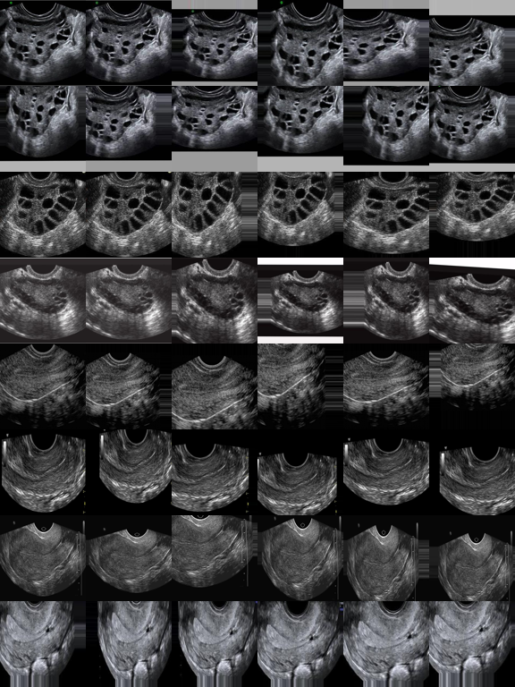

# Dataset audit

Generated by `scripts/audit_dataset.py`.

## 1. Exact duplicates

- Files on disk: **3856**
- Unique file contents: **1922**
- Contents present in *both* `train/` and `test/`: **1920**
- Same image with conflicting labels (dropped): 1

The provided test folder is essentially a copy of the training folder, so any accuracy measured on it shows memorisation, not generalisation.

## 2. Near-duplicates (augmentation families)

Images were embedded with an ImageNet MobileNetV3 and clustered (cosine distance < 0.15).

- Families per class: {'pcos_like': 13, 'normal': 9}
- Largest family sizes: [369, 276, 260, 170, 125, 117, 98, 87, 83, 60]

Each row above is one detected family. Many images are flips/zooms of the same scan.

## 3. Leakage-free split

Whole families are assigned to one split only (`splits/split.csv`).

| split | pcos_like | normal | families |
|---|---|---|---|
| train | 415 | 736 | 14 |
| val | 172 | 20 | 3 |
| test | 192 | 386 | 5 |

## 4. Other observations

- Many images in the `notinfected` class show the uterus rather than an ovary. A model can then learn *which organ is visible* instead of *what the ovary looks like* (shortcut learning). This must be fixed with better data before any result means something clinically.
- Images vary in size and some contain on-screen annotations or UI text from the scanner.